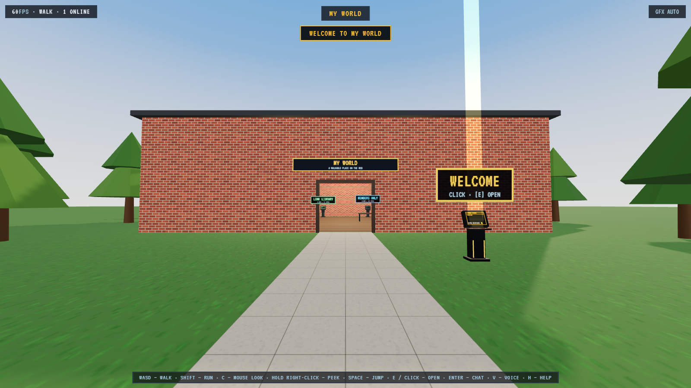

# Walkable World Starter

A starter kit for a **walkable first-person 3D world that runs in a browser tab**. Walk around a place you built,
bump into its walls, climb its stairs, and open links by walking up to a kiosk and pressing **E**. Other visitors
show up as avatars you can chat and talk with.

Everything is code: no model files, no downloaded textures, no API keys, no accounts. Clone it, run two commands,
and you are standing in the demo world.



## What you get

| Piece | File | What it does |
|---|---|---|
| Movement | `src/controls.js` | Counter-Strike-style movement (friction, acceleration, air-strafing), jump, sprint, mouse-look with pointer lock and a drag fallback, look smoothing, stair smoothing, head-bump under ceilings, fly and orbit cameras |
| World engine | `src/world.js` (top half) | Box colliders you can stand on, step-up stairs, wall pushout, static box batching (few draw calls), distance culling, sky with a fixed or real-time sun |
| Demo scene | `src/world.js` (bottom half) | A hall with a doorway, a stair to an upper floor, glass rails, crates to jump on. **Replace this with your place.** |
| Hotspots | `src/hotspots.js` | Kiosks with live retro screens and wall posters. Walk close + **E**, or click. Opens one link or a menu of links |
| Config | `src/config.js` | Spawn point, movement numbers, and the list of kiosks. Most edits happen here |
| Multiplayer | `src/multiplayer.js`, `server.js` | Everyone online appears as an avatar. One small Node server, no database |
| Chat + voice | `src/chat.js`, `src/voice.js` | Text chat (Enter) and proximity voice (V): you hear people near you, quieter with distance |
| Phones | `src/touch.js` | Thumb joystick, drag to look, tap to open |
| Private links | `server.js`, `private.example/` | Keep real names/links out of the public JavaScript and send them only to people with an unlock link |
| Tests | `scripts/verify.mjs` | Headless walkthrough: 27 checks covering doors, walls, stairs, jumps, kiosks, unlock, two-browser chat |
| Leak check | `scripts/scrub.mjs` | Fails if a word on your private list appears in the source or the built bundle |

## Run it

You need [Node.js](https://nodejs.org/) 20 or newer.

```bash
npm install
npm run dev          # http://localhost:5173  — single-player, live reload
```

For multiplayer, chat and voice, also run the server in a second terminal:

```bash
npm run build
npm run serve        # http://localhost:8080  — the real thing, as it will run in production
```

`npm run dev` proxies `/ws` and `/api` to that server, so with both running the dev page is multiplayer too. Open
two browser windows to see yourself as an avatar.

## Controls

| Key | Action |
|---|---|
| W A S D | Walk. Shift = run |
| C | Mouse look on/off (or hold right-click) |
| Space | Jump |
| E / click | Open the nearest kiosk or the one under the cursor |
| Enter or T | Chat. `/name NewName` renames you |
| V | Proximity voice on/off |
| H | Help card (mouse sensitivity and field-of-view sliders) |
| R / F / O | Respawn / free-fly camera / orbit camera |

## Make it yours

1. **Name it.** `SITE` in `src/config.js`.
2. **Change the kiosks.** Edit `HOTSPOTS` in `src/config.js`. Each entry has a name, a position in meters, and either
   a `url` or a `menu` of links.
3. **Build your place.** In `src/world.js`, replace the demo builders (`_hall`, `_upperFloor`, `_props`, `_trees`)
   with your own. The whole toolkit is four calls:

   ```js
   // a solid box: size (w, h, d), material, center (x, y, z)
   this.box(4, 3, 0.3, this.M.brick, 0, 1.5, -10, { collide: true });
   // a floor / path / decal
   this.plane(10, 10, this.M.planks, 0, 0.01, -10);
   // an invisible blocker (or a glass one: { seeThrough: true })
   this.addCollider(minX, maxX, minZ, maxZ, minY, maxY);
   // a text sign
   const sign = makeSign('HELLO', { mw: 4, mh: 0.5 });
   ```

   Colliders are boxes. Their tops are floors: anything up to 0.21 m above your feet is a step you glide up, anything
   taller needs a jump. That one rule gives you stairs, crates, tables and upper floors.
4. **Read [`docs/LESSONS.md`](docs/LESSONS.md) before you build anything big.** It is about 200 rules, each with the
   bug that caused it: movement feel, collision traps, performance, signs, multiplayer, private data, testing. It will
   save you days.
5. **Building with an AI coding assistant?** Point it at `docs/LESSONS.md` and `docs/BUILDING.md` first, and have it
   run `npm run verify` after every change to movement, collision or rendering.

## Test it

```bash
npm install -g playwright
npx playwright install chromium     # once
npm run build && npm run verify
```

The test starts the real server, walks the world in headless Chromium, and saves `verify-render.png`,
`verify-interior.png` and `verify-upstairs.png`. Look at the pictures after any rendering change: a build can pass
and a console can be clean while the screen is blank.

## Keeping private links out of the bundle

Everything in the JavaScript bundle is public: anyone can open the page source and read every label and URL in it.
If some of your kiosks point at things strangers should not even know exist, use the private overlay:

1. In `src/config.js`, give the kiosk a generic public name and a `privateId`. Leave `url` as `null`.
2. Copy `private.example/` to `private/` (which is git-ignored) and put the real name, links or menu under the same id.
3. Set a long random `UNLOCK_TOKEN` in your host's secret store, for example the output of
   `node -e "console.log(require('crypto').randomBytes(24).toString('base64url'))"`.
4. Send people `https://your-site/unlock/<token>`. It sets a cookie; from then on their browser gets the real data
   from `/api/world`. Everyone else gets a 403 and sees the generic kiosk.

This hides names and links from strangers. It is one shared token, not a login system: anything sensitive should
still sit behind its own login.

Before every push and deploy, list your private words in `scrub-words.txt` (git-ignored) and run:

```bash
npm run build && npm run scrub
```

## Deploy

It is one container: the Node server serves the built site, the WebSocket and the API on port 8080. Any host that
runs a Dockerfile works. For Fly.io, copy `fly.toml.example` to `fly.toml`, choose an app name, then:

```bash
fly launch --no-deploy --copy-config
fly secrets set UNLOCK_TOKEN=<your token>
fly deploy --ha=false
```

Run **one** instance. Presence is kept in memory, so two instances are two separate worlds.

## What is not included

The world this kit was distilled from also had ambient NPCs, sit-able chairs, mini-games played on in-world tables,
live data boards and an AI helper at a kiosk. Those were specific to that world and are left out, but
`docs/LESSONS.md` records how each was built and what went wrong, and `src/multiplayer.js` already carries the
game-relay channel they used.

## License

MIT. See [LICENSE](LICENSE).
